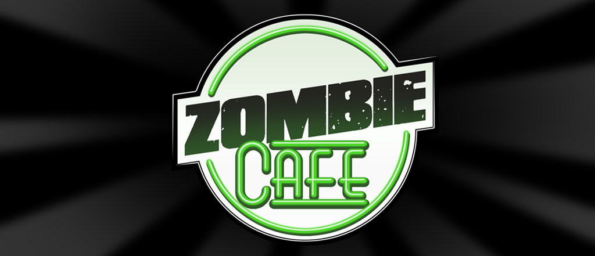

# Zombie Cafe Revival — Updated Phones / 64-bit

[](https://github.com/dazoarmando29/Zombie-Cafe-Revival-Project-Updated-Phones/releases)
[](https://github.com/dazoarmando29/Zombie-Cafe-Revival-Project-Updated-Phones/releases)
[](https://github.com/dazoarmando29/Zombie-Cafe-Revival-Project-Updated-Phones)
[](https://www.unicorn-engine.org/)
[-informational)](#building)

**The 2011 classic, revived for phones that no longer speak 32-bit.** The original game binary is preserved byte-for-byte and executed under an ARM32 CPU emulator — so Zombie Cafe runs natively-feeling on Pixel 7+, Android 14/15, and any 64-bit-only device.

> Base reverse engineering by **[Airyzz](https://github.com/Airyzz/zombie-cafe-revival)** — read the [revival article](https://airyz.xyz/p/zombie-cafe-revival/) for the technical background (smali fixes, runtime patcher, `.cct` textures, netcode). This fork adds the 64-bit emulation host, modern-Android fixes, and quality-of-life builds.

---

## Highlights

- **Runs on 64-bit-only devices** — the original `libZombieCafeAndroid.so` (32-bit ARM, closed source) is executed by a Unicorn-based emulation host built as `arm64-v8a`
- **Full gameplay** — cafe loads completely: chef, customers, zombies, furniture, dialogs, saving, music + SFX
- **No online required** — quests never demand friends, invites, or network services; friend/online quests from old saves auto-show as complete
- **Two build flavors** — vanilla and a Mod Menu variant (toxin / money / XP cheats)
- **Windows one-command build** — `build.ps1` produces a signed universal APK

---

## Downloads

Grab the latest APK from **[Releases](https://github.com/dazoarmando29/Zombie-Cafe-Revival-Project-Updated-Phones/releases)** and install it on your phone (allow "install from unknown sources" if asked). Install over any previous version — your save is kept.

| Variant | What you get |
|---|---|
| `ZombieCafe-Revival-vX.Y.Z.apk` | The game, plain and simple |
| `ZombieCafe-Revival-vX.Y.Z-ModMenu.apk` | Same game + cheat menu (**D** button, bottom-right corner) |

Both variants share the same app name — installing one replaces the other (save data is kept either way).

---

## How it works

The game is a 32-bit ARM binary. Modern phones dropped 32-bit support entirely. Instead of patching the game apart, this project keeps it **pristine** and runs it inside a CPU emulator that ships as a 64-bit library:

```
┌───────────────────────────── Android 15, arm64-v8a ─────────────────────────────┐
│                                                                                 │
│  Java / smali (patched)          libZombieCafeAndroid.so (zcr_host, arm64)      │
│  ┌──────────────────┐            ┌──────────────────────────────────────────┐   │
│  │ ZombieCafeAndroid│── JNI ───▶ │  35 Java_* entry points                  │   │
│  │ CapcomRenderer   │◀─ GL ──── │  JNI bridge (fake JNIEnv → real ART)      │   │
│  │ SoundManager     │            │  GLES1 passthrough (client arrays live)   │   │
│  └──────────────────┘            │  ┌────────────────────────────────────┐  │   │
│                                  │  │ Unicorn ARM32 core                 │  │   │
│  assets/engine/game.so ────────▶│  │ 0x10000000: original 32-bit engine │  │   │
│  (the untouched 2011 binary)     │  │ 0x70000000: 1.5 GB emulated heap   │  │   │
│                                  │  │ trap pages: 151 imported fns       │  │   │
│                                  │  └────────────────────────────────────┘  │   │
│                                  └──────────────────────────────────────────┘   │
└─────────────────────────────────────────────────────────────────────────────────┘
```

| ABI | `libZombieCafeAndroid.so` | Runs on |
|---|---|---|
| `armeabi-v7a` | original 32-bit engine (unchanged) | older devices, emulators |
| `arm64-v8a` | 64-bit host emulating the 32-bit engine | Pixel 7+, all modern phones |

### Emulation host (`host/`)

| File | Role |
|---|---|
| `zcr_host.cpp` | Replaces the game's `.so` (same soname). JNI entry points marshal into the emulated engine; mod-menu natives write emulated game state |
| `engine_loader.cpp` | ELF32 loader/relocator (engine at `0x10000000`), import trap stubs, runtime engine patches |
| `jni_bridge.cpp` | Fake JNIEnv/JavaVM vtables in emulated memory bridging to real ART — signature-aware varargs marshaling (float→double promotion, 64-bit alignment) |
| `stub_dispatch.cpp` | 16-byte trap slot per imported symbol (151 imports) |
| `emu_mem.cpp` | 1.5 GB emulated heap with block provenance (alloc/free caller tracking) and double-free rejection |
| `imports_posix.cpp` / `imports_gl.cpp` | libc/stdio/zlib/math and GLES1 handlers (GL client arrays resolved at draw time) |
| `diag.cpp` | Logging, crash-time trace ring, heap statistics |

---

## Repository layout

```
├── build.ps1              # Windows build pipeline (also -ModMenu, -Install, -Clean)
├── host/                  # the arm64 emulation host (C++/NDK) — see table above
│   ├── generated/         # AUTO-GENERATED engine tables (regenerate: tools/gen_tables.py)
│   └── tools/             # engine table generator, Unicorn build script
├── patches/               # Java-side fixes, copied over the decoded tree every build
├── patches-mod/           # mod-menu overlay (extra classes + button), applied with -ModMenu
├── src/                   # original revival sources (assets, tools, 32-bit libs)
├── tool/                  # Go asset pipeline (human-readable → game formats)
└── build/                 # scratch: apktool tree + outputs (gitignored)
```

---

## Building

### Requirements

- cmake + ninja
- Go 1.23+
- apktool (Java 17+)
- Android NDK r27+ and build-tools 35 (apksigner)
- Python 3 (diagnostic tooling)

### Quick start (Windows)

```powershell
.\build.ps1                # vanilla APK -> build\out\out.apk
.\build.ps1 -ModMenu       # mod-menu APK -> build\out\out-mod.apk
.\build.ps1 -Install       # build + adb install
.\build.ps1 -Clean         # wipe build output first
```

Install/test manually:

```powershell
adb shell am force-stop com.capcom.zombiecafeandroid
adb install -r --bypass-low-target-sdk-block build\out\out.apk
adb shell am force-stop com.capcom.zombiecafeandroid   # always re-stop after install!
adb shell am start -n com.capcom.zombiecafeandroid/.ZombieCafeAndroid
```

> **Note:** `patches/` is applied to the decoded APK tree on every build, so Java-side fixes survive clean checkouts. The vanilla build also deletes leftover mod-menu classes so the clean APK stays clean.

---

## Engine patching

Runtime patches are applied to the emulated engine at load time in `engine_loader.cpp → engine_apply_zcr_patches()` (addresses are RVAs into the original binary):

| Patch | What it does |
|---|---|
| URL strings | Redirect updater/services to the revival endpoints |
| `0x9dee8` NOP | Original runtime patcher behavior |
| `0xab018` | Money-buy → toxin-buy (in-game store behavior) |
| `0xeae24` → cave `0x11000000` | `getObjectiveCompletion()` reports friend/online objective types (1/5/7/8/9) as complete — stuck quests in old saves become tap-to-claim |
| `0xeba72` | `loadNewSet`: `createSocialObjective` → `createServingObjective` — new quest sets never require friends |
| `0xeafec` NOP | `createRaidObjective` always targets local enemy cafes (never friend cafes) |

> **Patching rules learned the hard way** — trampoline stubs must use `b.w`, never `bl` (branch-with-link overwrites LR; the stub's `bx lr` would return into itself and loop forever). Cave pages must live within ±16 MB of the call site. Always round-trip-verify Thumb BL/B encodings before building. See the debugging guide below.

---

## Mod menu

The optional **-ModMenu** build adds a small **D** button (bottom-right) with: `+1 toxin`, `Max toxin`, `+1 money`, `+10k money`, `Max money`, `+10k XP`, `Max XP`.

The natives (`DebugAddMoney`, `DebugSetToxin`, `DebugAddXp`, `DebugSetXp`) write directly into the emulated game object at known RVAs (ported from **[LemL0/Zombie-Cafe-Revival-2.0](https://github.com/LemL0/Zombie-Cafe-Revival-2.0)** — thanks LemL0!). They are inert in the vanilla build.

---

## Debugging guide

### Device workflow

- **Capture logs first** (Vivo logd rotates fast — `logcat -d` shows nothing):
  ```powershell
  Start-Process cmd -ArgumentList '/c "adb" logcat -v time > %TEMP%\zcr_stream.txt 2>&1' -WindowStyle Hidden
  ```
  Launch the app only after the capture is running, then grep the file.
- **Screenshots**: `adb shell screencap -p /sdcard/x.png`, pull, resize to ~700 px JPEG. File size is diagnostic: ~20 KB = nothing drawn, ~2 MB = real content.
- **View bounds**: `adb shell uiautomator dump` then pull `/sdcard/ui.xml` — shows real clickable bounds (found the tiny mod button this way).

### Log markers (`zcr`, `zcr-engine`, `zcr-heap`, `zcr-jni`)

| Marker | Meaning |
|---|---|
| `[mem-fault]` + `[regs]` + `[strchain]` | Full register dump, heap-block provenance, and String lookup chain at a crash |
| `[heapstat]` / `[heaplr]` | Heap totals and **live bytes per allocation site** — leak finder |
| `[alloc648]` | Filtered allocation log with emu stack words (mini-backtrace) — a repeating pattern = the loop |
| `[badfree]` / `EXHAUSTED` | Rejected frees (with caller) / out-of-heap |
| `[trace]` | Ring buffer of recent engine→Java calls (noise-filtered) |

### Hard-bug playbook

1. **Silent hang (no faults, idle CPU)** → suspect a patch clobbering LR (`bl` vs `b.w`), or a zero-length `replace()`/search loop. Bisect with per-patch toggles.
2. **Garbage pointers at a crash** → classify first: stable address + foreign content = **out-of-bounds** (find the index/offset math); varying garbage = **use-after-free** (check `[badfree]` and provenance). Never "fix" it by raising memory limits.
3. **Everything breaks after launch rotation** → screen-size capture raced the orientation lock; normalize `width/height` at every size source.
4. **Data quietly wrong** → check host-side caps (the magenta screen was a silent 4 KB `strlen` cap truncating an 18 KB strings file to 41 of 662 entries). Any host string helper must allow ≥16 MB and stay inside mapped regions.

---

## Roadmap

- [x] Phase 0 — Windows build pipeline (`build.ps1`)
- [x] Phase 1 — Android 10–15 compatibility (install flags, runtime permissions)
- [x] Phase 2 — `host/` arm64 emulation layer (Unicorn, JNI/GL bridging)
- [x] Phase 3 — Universal APK, menu + cafe fully playable, saving, audio
- [x] Offline-first quests (no friend/online requirements)
- [x] Mod-menu variant (separate release)
- [ ] Online services revival (`tool/server`) — opt-in
- [ ] Polish: larger mod button, quieter online hooks

---

## Credits

- **[Airyzz](https://github.com/Airyzz/zombie-cafe-revival)** — original reverse engineering & revival ([technical write-up](https://airyz.xyz/p/zombie-cafe-revival/))
- **[LemL0](https://github.com/LemL0/Zombie-Cafe-Revival-2.0)** — mod menu reference and cheat offsets
- **[Unicorn Engine](https://www.unicorn-engine.org/)** — the CPU emulator that makes this possible
- Zombie Cafe is a trademark of Capcom. This is a fan preservation project; no assets are hosted beyond what the original game shipped.

<sub>Found a bug? Open an issue — logs from the `zcr` tags above make fixes 10× faster.</sub>
